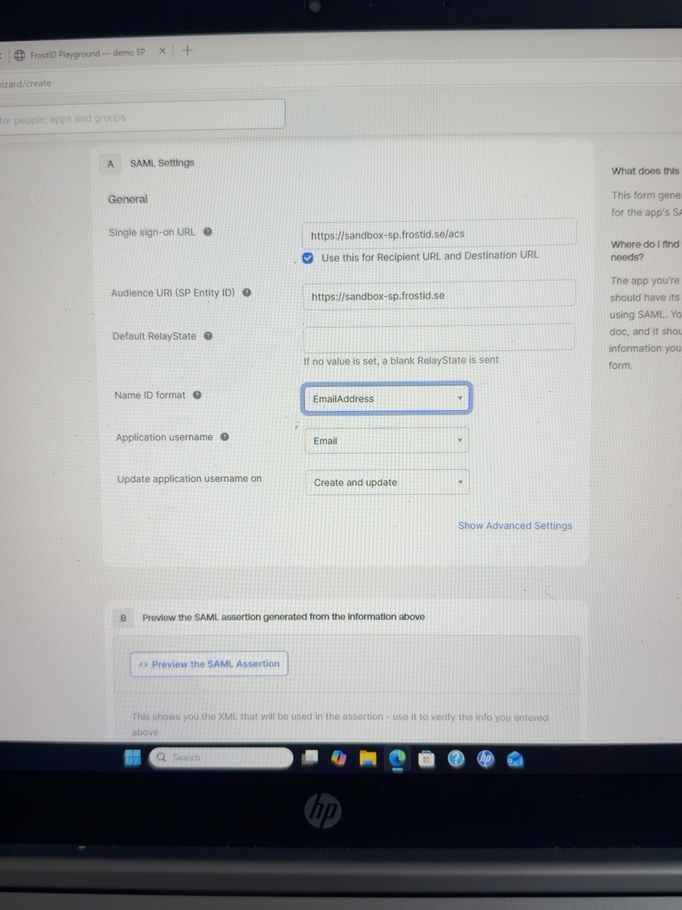
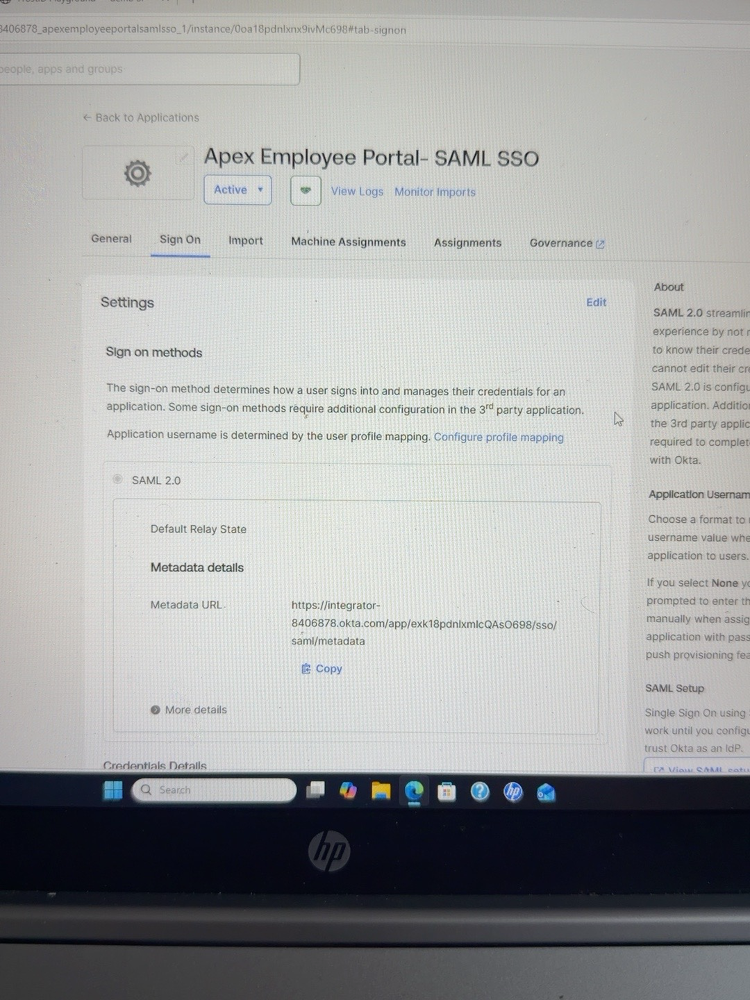
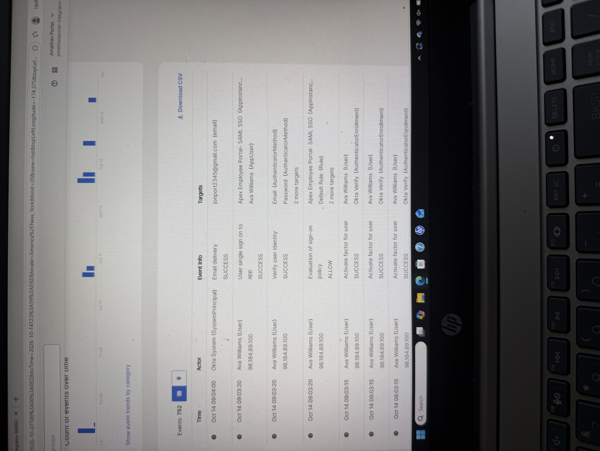

# Okta SAML 2.0 SSO Integration — Apex Employee Portal

## Project Overview
Configured and tested a SAML 2.0 single sign-on integration between Okta (Identity Provider) and FrostID Playground (Service Provider) for a fictional Apex Employee Portal.

## Objectives
- Configure a custom SAML 2.0 application in Okta.
- Establish trust using Service Provider and Identity Provider metadata.
- Assign a test user to the application.
- Validate SAML authentication and assertion security checks.
- Troubleshoot an incorrect SAML NameID mapping.

## Lab Environment
- Identity Provider: Okta Integrator Free Plan
- Service Provider: FrostID SAML 2.0 Playground
- Application: Apex Employee Portal — SAML SSO
- Test identity: Ava Williams
- Protocol: SAML 2.0

## Implementation
1. Created the custom SAML application in Okta.
2. Configured the Service Provider ACS URL as `https://sandbox-sp.frostid.se/acs`.
3. Configured the SP Entity ID as `https://sandbox-sp.frostid.se`.
4. Set the NameID format to EmailAddress and the application username source to Email.
5. Assigned Ava Williams to the SAML application.
6. Supplied Okta's IdP metadata URL to the FrostID test harness and confirmed that the metadata was valid.
7. Executed an SP-initiated SAML login test.
8. Reviewed Okta System Log events for application SSO, identity verification, and sign-on policy evaluation.

## Troubleshooting — Incorrect NameID
The first successful SAML response contained an unexpected NameID, `jonport2345@gmail.com`, even though the Okta System Log identified Ava Williams as the actor. Investigation of Ava's application assignment showed that her application username had been overridden with that address.

Updated the application-specific username to `ava.williams@jonathanporter.dev`, saved the change, and repeated the SAML login test.

## Validation Results
- Okta IdP metadata: Valid
- SAML login: Successful
- SAML response signature: Verified by FrostID
- Audience: Verified
- InResponseTo: Verified
- Assertion validity window: Verified
- Final NameID: `ava.williams@jonathanporter.dev`
- Okta System Log: Successful application SSO and identity verification; sign-on policy evaluation allowed

## Security Lessons
- Successful SSO does not guarantee that identity attributes are mapped correctly.
- Application-specific username overrides can change the SAML NameID.
- System Logs and Service Provider assertion validation provide complementary troubleshooting evidence.
- Authentication, authorization, and attribute mapping should be validated separately.

## Evidence

### 1. SAML Configuration

#### 2. Okta Application Sign-On Settings

### 3. Ava Williams Application Assignment

### 4. Okta IdP Metadata Added to FrostID

### 5. Okta System Log — Successful SSO

## Outcome
Successfully configured and validated SAML federation between Okta and a test Service Provider, identified and corrected an application username mapping issue, and verified the corrected SAML assertion.
