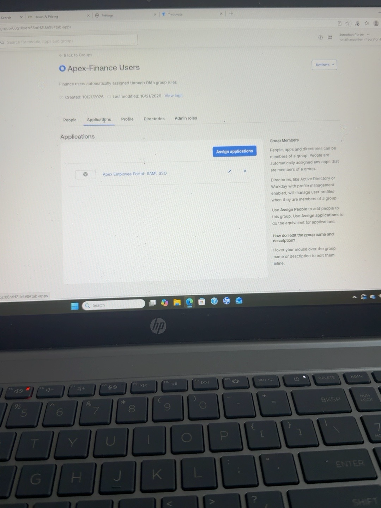
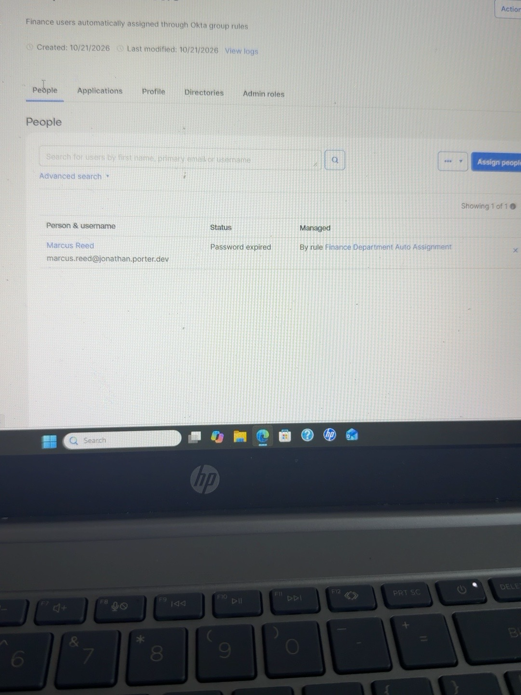
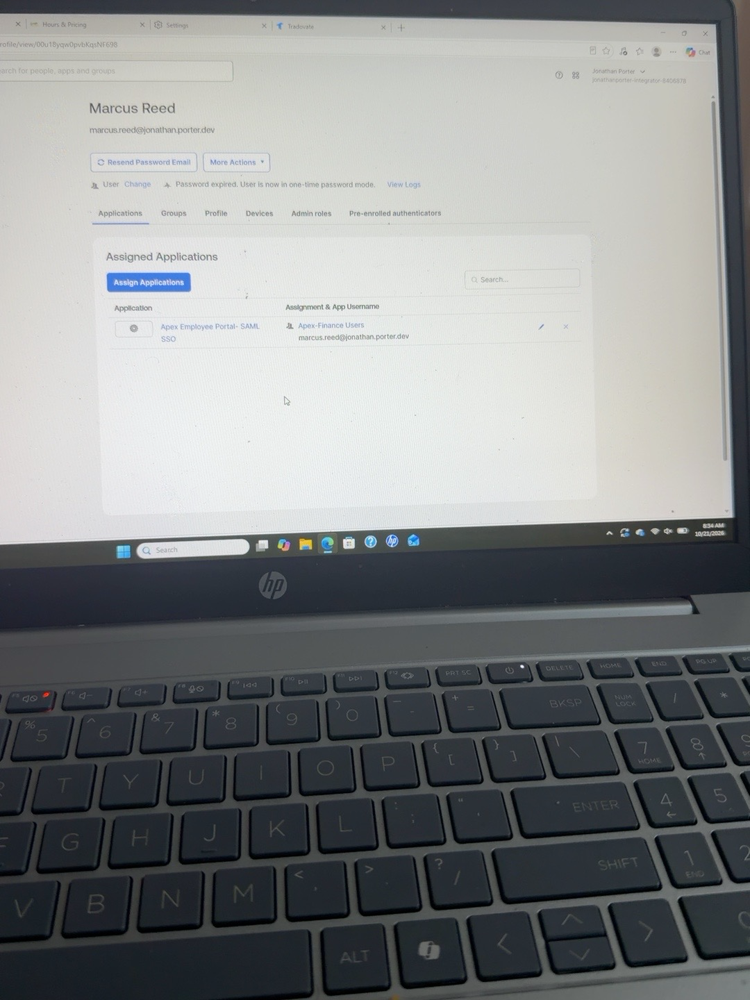
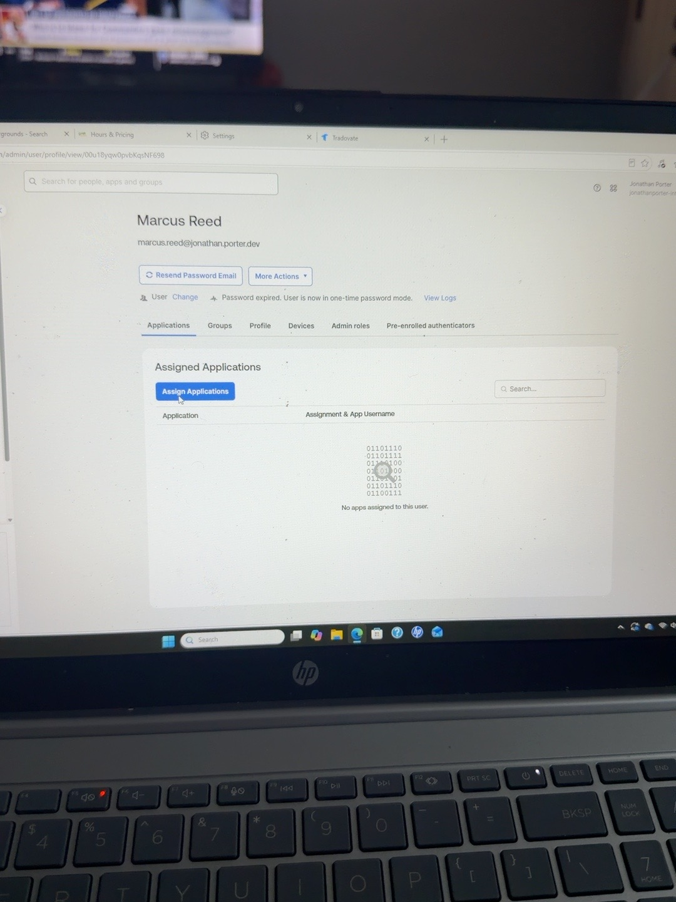
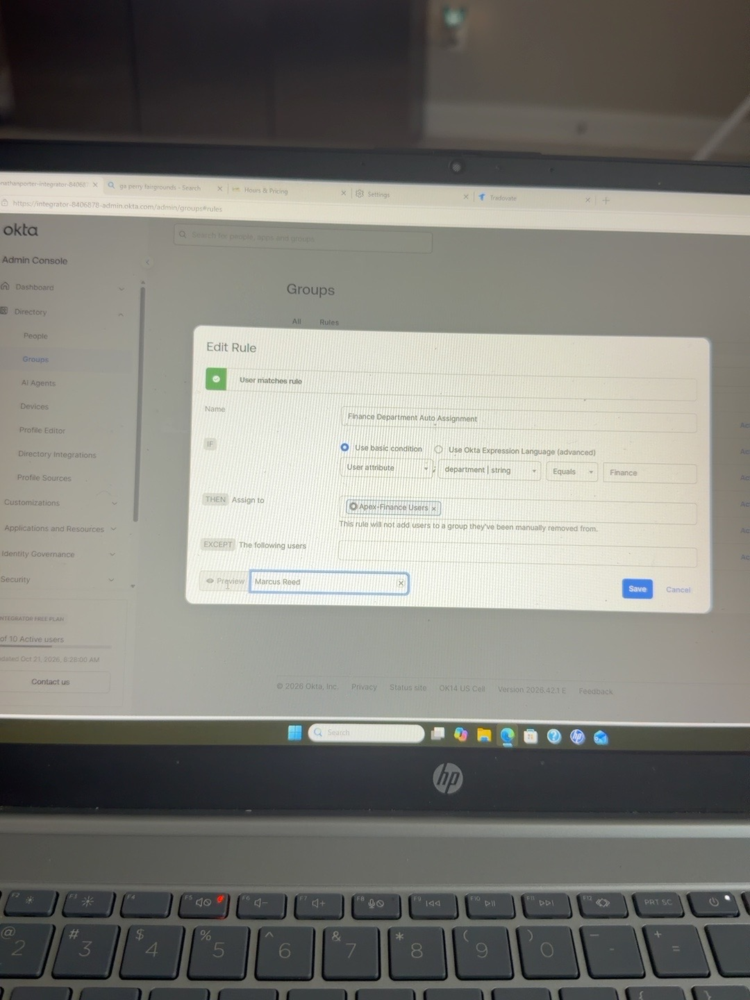
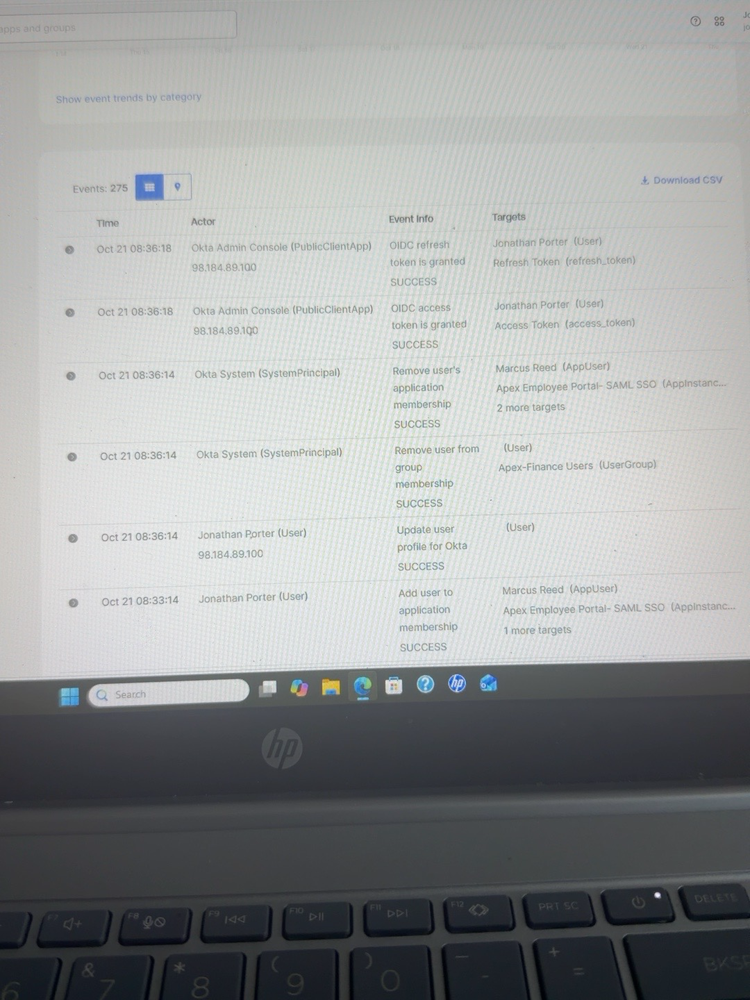
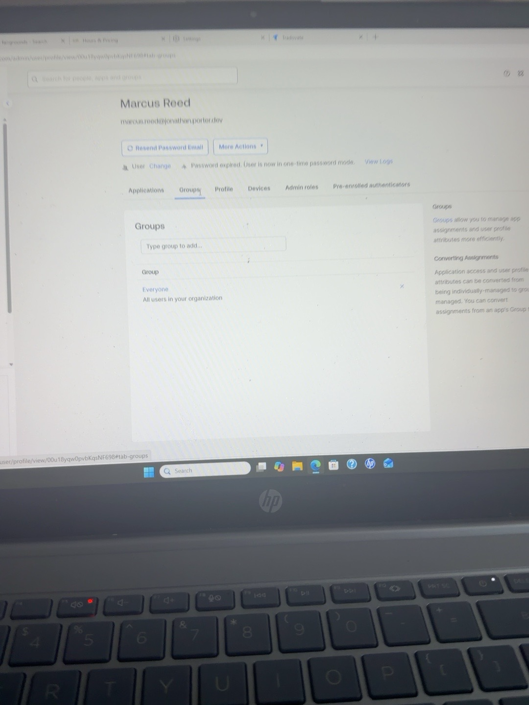
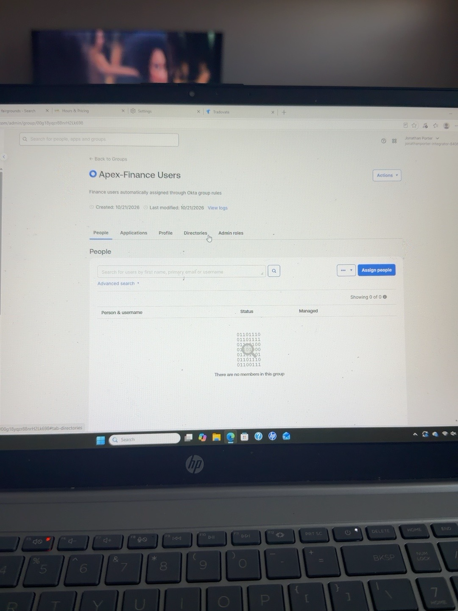

# Okta Group Rules & Automated Access — Apex Finance Users

## Project Overview

Built and validated an automated access control workflow in Okta using user attributes, group rules, group-based application assignment, and lifecycle-driven access removal.

The project demonstrates how identity attributes can dynamically control access without requiring manual user-by-user assignments.

## Objective

- Create a test user with a department attribute
- Build a Finance-specific Okta group
- Create a group rule based on `department = Finance`
- Automatically add the user to the Finance group
- Assign application access to the group
- Verify inherited application access
- Change the user's department from Finance to HR
- Confirm automated group removal and application access revocation
- Validate the full lifecycle in the Okta System Log

## Lab Environment

- Identity Provider: Okta Integrator Free Plan
- Test User: Marcus Reed
- Initial Department: Finance
- Updated Department: HR
- Group: Apex-Finance-Users
- Application: Apex Employee Portal – SAML SSO
- Access Method: Group Rule + Group-Based Application Assignment

## Implementation

1. Created Marcus Reed as a test user in Okta.
2. Set the user's Department attribute to `Finance`.
3. Created the `Apex-Finance-Users` group.
4. Created the `Finance Department Auto Assignment` group rule.
5. Configured the rule condition:
   - User attribute: `department`
   - Operator: `Equals`
   - Value: `Finance`
6. Verified Marcus Reed matched the rule.
7. Activated the rule and confirmed Marcus was automatically added to the Finance group.
8. Assigned `Apex Employee Portal – SAML SSO` to the Finance group.
9. Verified Marcus inherited application access through `Apex-Finance-Users`.
10. Changed Marcus Reed's Department from `Finance` to `HR`.
11. Confirmed Marcus was automatically removed from the Finance group.
12. Confirmed inherited application access was automatically revoked.
13. Reviewed the Okta System Log to verify the profile update, group removal, and application membership removal events.

## Automation Flow

`Department = Finance`  
↓  
`Finance Department Auto Assignment`  
↓  
`Apex-Finance-Users`  
↓  
`Apex Employee Portal – SAML SSO`

When the user's department changed to HR:

`Department = HR`  
↓  
`Finance rule no longer matched`  
↓  
`Finance group membership removed`  
↓  
`Application access revoked`

## Validation Results

- Group rule matched the Finance department attribute
- User was automatically added to Apex-Finance-Users
- Application access was inherited through the group
- Department change caused automatic group removal
- Group removal caused application access revocation
- Okta System Log confirmed the full lifecycle sequence

## Security Lessons

- Attribute-driven access reduces manual administration.
- Group-based application assignment scales better than direct user assignment.
- Automated deprovisioning is just as important as automated provisioning.
- User profile changes can drive real-time access decisions.
- System Logs provide critical audit evidence for IAM lifecycle events.

## Evidence

The following screenshots document the Okta Group Rules & Automated Access lab.

### Screenshot 1

### Screenshot 2

### Screenshot 3

### Screenshot 4

### Screenshot 5

### Screenshot 6

### Screenshot 7

### Screenshot 8

